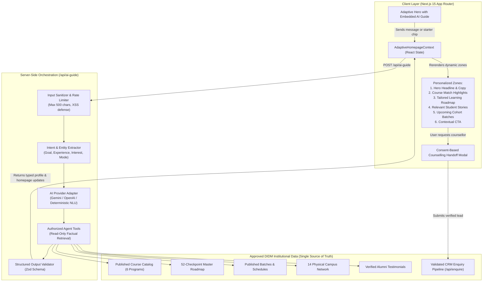

# DIDM AI Agent Architecture & Data Flow

**Document:** `DIDM_AI_AGENT_ARCHITECTURE.md`  
**Date:** November 20, 2026  
**Status:** Production Implementation Specification  

---

## 1. System Architecture Overview

The **DIDM Adaptive Homepage** architecture consists of three integrated layers:

---

## 2. Server-Side Agent Orchestration (`/api/ai-guide`)

### 2.1 Request & Response Lifecycle
1. **Client Request**: Receives user query (`message`), conversation history (`history`), and current profile state (`currentProfile`).
2. **Sanitization**: Validates string bounds (2 to 500 characters), strips malicious injection patterns, and checks client rate limits.
3. **Intent Classification**: Identifies user persona (`student`, `career_switch`, `business_owner`, `freelancer`, `explorer`), skill interests (`SEO`, `Ads`, `AI`, `Social Media`), and preferences (`classroom`, `online`, `weekday`, `weekend`).
4. **Tool Execution**: Resolves factual courses, batches, and roadmaps using deterministic functions.
5. **Structured Synthesis**: Compiles a natural, supportive reply in the user's language (English, Hindi, or Hinglish) alongside validated profile and homepage update directives.
6. **Graceful Fallback**: If an external LLM call encounters a timeout or network error, an internal deterministic rule engine provides the verified response within 20ms.

---

## 3. Authorized Tool Interface

The AI agent has access only to **read-only, verified institutional discovery tools**:

| Tool Function | Parameters | Description |
| :--- | :--- | :--- |
| `searchPublishedCourses` | `query: string, mode?: string` | Searches the 6 approved DIDM courses (`midm`, `advanced`, `dmi`, `customized`, `online`, `gen-ai-knowledge-camp`). |
| `getCourseDetails` | `courseId: string` | Returns official modules, duration, toolstacks, and eligibility for a course. |
| `getPublishedUpcomingBatches` | `courseId?: string, centreId?: string` | Returns real, upcoming cohort dates from MongoDB/static verified registry. |
| `getTrainingCenters` | `region?: string` | Returns official campus details across Delhi NCR and regional branches. |
| `getApprovedFaqAnswers` | `topic: string` | Retrieves verified answers on placement assistance, backup classes, and LMS access. |
| `getVerifiedStudentStories` | `category?: string` | Returns authentic student feedback and quotes. |
| `getCareerRoadmap` | `goal: string, experience: string` | Returns structured 5-6 step learning progression with practical milestones. |

### Security Guarantees:
- **No SQL or direct database queries generated by model output.**
- **No access to student PII, credentials, or administrative endpoints.**
- **No automatic lead creation without explicit user form submission.**

---

## 4. Multi-Language & Tone Protocol

- **Languages Supported:** English, Hindi (Devanagari), and Hinglish (Latin script Romanized Hindi).
- **Tone Guidelines:**
  - Warm, encouraging, academic, and practical.
  - Concise replies (2 to 4 sentences maximum per turn).
  - Always asks a single, low-pressure follow-up question or suggests 2-3 clickable next steps.
  - Transparently indicates that recommendations are guidance, not guaranteed placement or salary claims.
