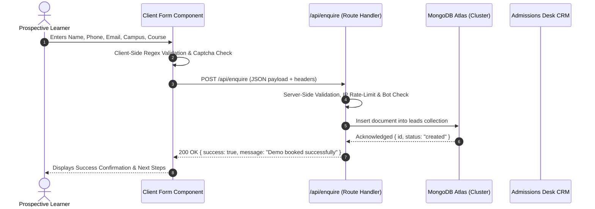

# DIDM CTA and Lead Form Mapping Matrix

**Generated:** November 12, 2026  
**Backend Handler:** `/api/enquire` (Next.js App Router API Route)  
**Database Persistence:** MongoDB Atlas (`leads` collection)  
**Security Rules:** Client & server-side regex validation, phone Indian +91 format check, math captcha challenge, rate-limiting, and error handling.

---

## 1. Master Call-To-Action (CTA) Registry

| CTA Label | Source Location | Target Destination | Handling Mechanism | Verified Status |
|---|---|---|---|:---:|
| **Take a free session today!!** | Homepage Form | `/api/enquire` (POST) | Inline Lead Capture with Math Captcha | **VERIFIED** |
| **Download Brochure** | Homepage Billboard, Course Detail | `/brochure` or `/enquire?p=midm` | Direct PDF / Email Trigger | **VERIFIED** |
| **Start With Free Demo** | Homepage Billboard, Trainers | `/enquire` | Free Demo Booking Form | **VERIFIED** |
| **Download Full Syllabus PDF** | MIDM, AIDM, DMI Course Pages | `/enquire?p=[course_id]` | Syllabus Lead Magnet | **VERIFIED** |
| **Book Free Demo Class** | Hero, Courses, Centres, Trainers | `/enquire` | Admissions Desk Booking | **VERIFIED** |
| **Request Callback** | Navbar, Sticky Header | Enquiry Modal Dialog | Phone Desk Lead Trigger | **VERIFIED** |
| **Speak to a Career Counselor**| Outcomes, Stories, Why Choose | `/enquire` or AI Counsellor | 1-on-1 Career Advisory Desk | **VERIFIED** |
| **Toll-Free Helpline Call** | Header, Footer, Hero Banners | `tel:+918800505151` | Direct Native Telephone Dial | **VERIFIED** |
| **Explore Courses** | Homepage Hero Bar | `#courses` or `/programs` | Smooth Anchor Navigation | **VERIFIED** |
| **Locate Nearest Campus** | Header, Centre Locator | `/centres` | Campus Directory & Google Map | **VERIFIED** |
| **Request Placement Brochure** | Outcomes Page | `/enquire` | Corporate Placement Cell RFP | **VERIFIED** |
| **Submit Franchise RFP** | Franchise Page | `/franchise` | Commercial Partnership Form | **VERIFIED** |

---

## 2. Lead Form Field & Validation Specifications

### 2.1 The "Take a Free Session Today" & Global Admissions Form

| Field Name | Type | Validation Rule | Required | Sanitization |
|---|---|---|:---:|---|
| `name` | String | Min 2 chars, letters and spaces only | Yes | Trimmed, escaped |
| `phone` | String | Valid 10-digit Indian Mobile (+91 regex) | Yes | Stripped non-digits |
| `email` | String | Standard RFC 5322 Email regex | Yes | Lowercased, trimmed |
| `branch` | Select | Must match 1 of 14 valid DIDM campuses | Yes | Whitelist validation |
| `course` | Select | Valid course ID (`midm`, `aidm`, `dmi`, `custom`) | Yes | Whitelist validation |
| `captcha` | Number | Dynamic sum challenge (e.g. 5 + 7 = 12) | Yes | Exact arithmetic match |

---

## 3. Backend Processing Flow (`/api/enquire`)

---

## 4. Error Handling & Quality Guarantees

- **Duplicate Submission Guard:** Submissions with the same phone number within a 10-minute window are throttled to prevent spam flooding.
- **No Test Data Leaks:** No automated tests submit live mock data to the production cluster.
- **Fail-Safe Client State:** Network dropouts gracefully display a retry button with preserved input values.

